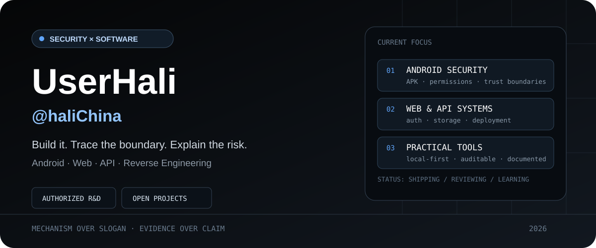

  

###  Hello, I'm Hali

  <a href="https://userhali.com"><strong>Website</strong></a> ·
  <a href="https://status.userhali.com">Status</a> ·
  <a href="mailto:admin@userhali.com">Email</a>

I build security-aware web systems and local-first browser tools. Same sequence every time: understand the mechanism → locate the trust boundary → state the limits.

## Work

- **[2fa](https://github.com/haliChina/2fa)** — browser-local TOTP
- **[MCC2T](https://github.com/haliChina/MCC2T)** — Microsoft cookie → Minecraft token chain
- **[Image-Obfuscation](https://github.com/haliChina/Image-Obfuscation)** — reversible pixel permutation
- **[VibeChat](https://github.com/haliChina/VibeChat)** — local `llama.cpp` or remote OpenAI-compatible chat
- **[tinylink-nextjs](https://github.com/haliChina/tinylink-nextjs)** — short links + analytics
- **[AboutHali](https://github.com/haliChina/AboutHali)** — WebGL homepage for [userhali.com](https://userhali.com)

## Stats

  
  

<!--
  统计卡是构建期抓取并提交的静态快照，不会自动刷新。
  原因：原先直连 github-stats-extended.vercel.app，该域名在 *.vercel.app 段内，
  中国大陆常遭 DNS 污染，境内访客必然看到破图。改为提交到本仓库、走
  raw.githubusercontent.com（同为境外，但 GitHub 主域未被污染，稳定性更好）。

  刷新方式：在能访问该服务的网络下重新抓取后提交即可 ——
  node scripts/gen-stats.mjs   （脚本见 haliChina/AboutHali 仓库）
-->
